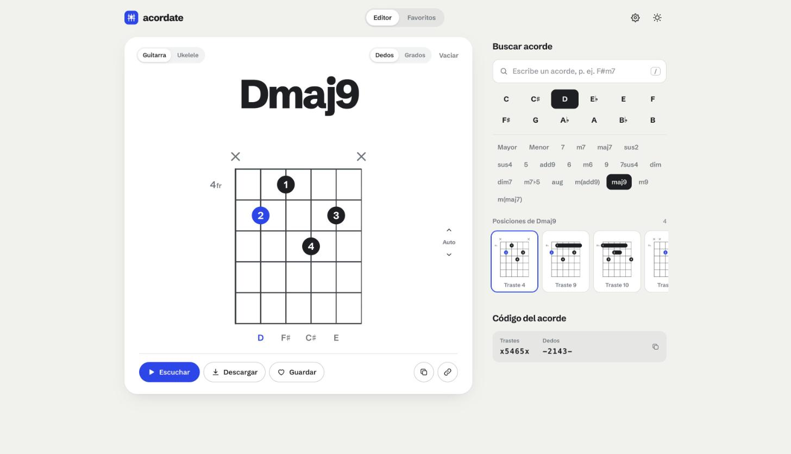
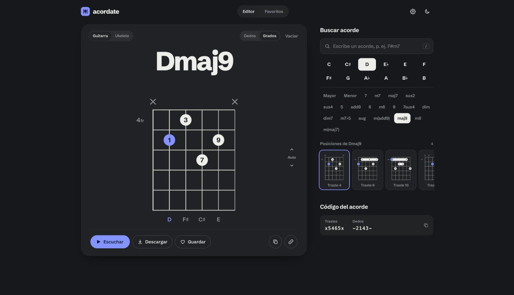

<div align="center">

# acordate

**Diagramas de acordes para guitarra y ukelele, claros y listos para compartir.**

[Abrir la app](https://franpiaggio.github.io/acordate/) · [Ver un ejemplo](https://franpiaggio.github.io/acordate/#Dmaj9.png?p=x5465x&f=-2143-)



</div>

## Qué es

Acordate es un generador de diagramas de acordes. Tocas el diapasón, escuchas cómo suena y descargas una imagen nítida para tus apuntes, tu cancionero o tus clases. Funciona en el celular, la tablet y la computadora.

## Funciones

**Editar tocando el diagrama**
- Un toque en una casilla pone una nota. Un toque sobre la cejuela alterna entre cuerda al aire y apagada.
- Tocar una nota abre un menú para elegir el dedo (1 a 4, o T para el pulgar) o quitarla.
- Los dedos se asignan solos, con cejilla cuando hace falta. Si la forma necesita más de cuatro dedos, la app lo avisa.
- El nombre del acorde se detecta a partir de las notas (C, Am7, D/F♯…), y puedes cambiarlo.

**Dedos o grados**
- Los puntos pueden mostrar qué dedo usar o qué grado es cada nota respecto de la tónica (1, ♭3, 5, ♭7, 9…). Sirve para entender cómo está armado el acorde.

**Buscar acordes**
- Escribe un acorde, como `F#m7`, o elige tónica y tipo entre 21 tipos.
- Cada acorde trae varias posiciones a lo largo del mástil, con las formas abiertas más conocidas primero.

**Escuchar**
- El acorde suena con grabaciones reales de cada cuerda en tres intensidades, y cada cuerda suena mientras editas.

**Descargar y compartir**
- PNG en cuatro tamaños o SVG, con fondo claro, oscuro o transparente. La tipografía va incluida en el archivo.
- Copia la imagen al portapapeles o comparte un enlace que abre el mismo acorde.

**Compositor**
- Elige una tonalidad (mayor o menor) y el compás (4/4, 3/4 o 6/8). La app te muestra los acordes de esa tonalidad con su grado (I, ii, V…).
- Arrastra acordes a los compases, o toca un compás y después un acorde. Arrastrar un compás sobre otro los intercambia.
- Crea acordes propios dibujándolos en el diapasón sin salir del compositor. Quedan como fichas para reusarlos.
- Toca un compás para cambiar su acorde: ves sus variantes (maj7, sus4, add9…) y otras posiciones en el mástil.
- Reproduce la secuencia en bucle con estilos de rasgueo y metrónomo opcional. En 4/4: Un golpe, Balada, Pop, Rítmico, Folk, Arpegio, Bossa nova, Swing, Shuffle, Reggae, Tango y Milonga. En 3/4: Vals. En 6/8: Balada, Arpegio, Chacarera y Zamba.
- La biblioteca trae unas 50 progresiones típicas de 12 géneros (pop, rock, blues, jazz, bossa nova, folklore, tango, latino, reggae, soul y funk, folk y country, baladas), cada una con su compás, tempo y rasgueo. Un toque la carga y la reproduce, y puede pasarse a tu tónica.
- Exporta la progresión como imagen PNG, audio WAV, archivo MIDI, texto o enlace.

**Favoritos**
- Guarda acordes en una sección aparte, ábrelos cuando quieras y descárgalos todos juntos en una sola imagen.

**Ajustes**
- Trastes visibles, nombres de notas, tónica en color, cejilla completa, vista para zurdos y tema claro u oscuro.

<div align="center">

</div>

## Atajos

| Tecla | Acción |
|---|---|
| `Espacio` | Escuchar el acorde |
| `/` | Ir al buscador |
| `Esc` | Cerrar menús |

## Enlaces

Cada acorde tiene su propia dirección:

```
https://franpiaggio.github.io/acordate/#D.png?p=xx0232&f=---132
```

- `p`: trastes de grave a aguda (`x` apagada, `0` al aire). Para trastes de dos cifras, separa con guiones: `x-10-12-12-11-x`.
- `f`: dedos (`1`–`4`, `T`, `-`).
- `i=uke`: ukelele.
- `w=5`: fija el traste inicial del diagrama.
- `#favoritos` abre la sección de favoritos.
- `#compositor?k=0&m=major&t=4&bpm=90&s=C,G,Am,F` abre el compositor con esa progresión (`k` tónica de 0 a 11, `m` major o minor, `t` 3, 4 o 6 para 6/8, `-` deja un compás vacío).

## Correrlo en tu computadora

Es un sitio estático, sin build ni dependencias. Sirve la carpeta con cualquier servidor:

```bash
python3 -m http.server 4173
# abre http://localhost:4173
```

Si abres `index.html` directo, sin servidor, todo funciona salvo las muestras de sonido: en ese caso suena un sintetizador.

## Estructura

```
index.html
css/styles.css      estilos, temas y diseño responsive
js/theory.js        notas, tipos de acorde, detección, posiciones y digitación
js/render.js        dibuja los diagramas en SVG (editor, miniaturas y descargas)
js/audio.js         reproducción con muestras y sintetizador de respaldo
js/app.js           estado, interfaz, vistas, enlaces, descargas y favoritos
js/composer.js      compositor: tonalidad, compases, reproducción y exportación
js/library.js       biblioteca de progresiones por género
assets/guitar/      grabaciones por cuerda (trastes 0 a 12, tres intensidades) y su tabla de volumen
assets/samples/     13 muestras de respaldo
docs/               capturas para este README
```

## Créditos

- Sonido de guitarra por cuerda: grabaciones de guitarra de los [University of Iowa Musical Instrument Samples](https://theremin.music.uiowa.edu/MISguitar.html), de uso libre.
- Sonido de respaldo: [tonejs-instruments](https://github.com/nbrosowsky/tonejs-instruments), bajo licencia [CC BY 3.0](https://creativecommons.org/licenses/by/3.0/).
- Tipografía: [Schibsted Grotesk](https://fonts.google.com/specimen/Schibsted+Grotesk).
